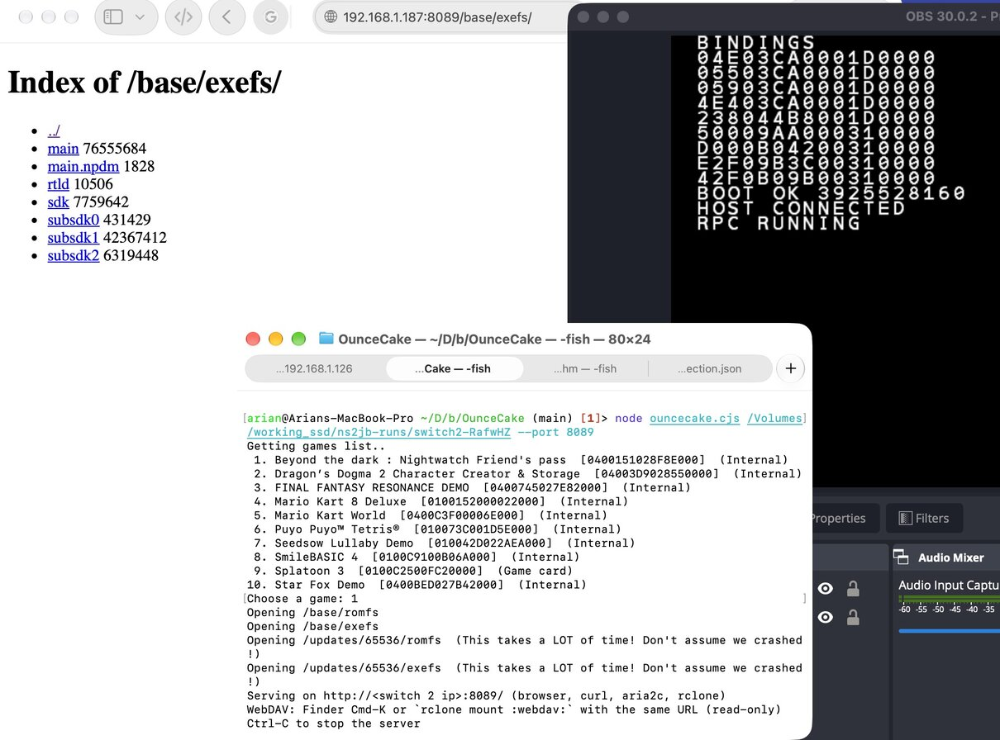

# OunceCake Fork!!!

It adds the following features to [the original](https://github.com/misshexa66/OunceCake):

* **Replaces the FTP file server with HTTP/WebDAV**.
  - Allows you to open the contents of any title in either a web browser, mount it in your OS with WebDAV, use wget, etc.
  - Possibly faster than FTP but I haven't actually confirmed this bc I never used the FTP version Lol



* Can dump **full system firmware titles** with RomFS as well as ExeFS.
  - So that you can view the contents of applets (e.g. MiiEdit).
* Dumping of **system data archives**.
  - e.g., MiiModel (0400000000000849) for Mii rendering resources.

(... Can you guess why I did this fork to begin with 😅)

* Builds the native server with clang/lld instead of gcc.
  - Should be hopefully more cross-platform.
  - Also has a vibe-coded "test harness" meant for the macOS host. This can probably be made more portable.

## Instructions

> _This section was written by Claude along with the rest of the code, if you can make it suck less feel free to open a PR_

### Prerequisites

* A Switch 2 running the kurumuz fork of **ns2jb** (`node run.cjs --rpc`), on the same machine or reachable from it.
  - The `--rpc` flag is important: it tells ns2jb to hold the exploit session open after the user payload runs...
  - ... so OunceCake can reattach over the retained FS/Loader roots.
* The run directory ns2jb prints at the end of its exploit
  (something like `.../ns2jb/runs/switch2-XxYyZz/`).
  - OunceCake takes that path as its first argument.
  - Specifically, it reads: `switch2/current-acquisition.json`,
  `switch2/ro/root/current-root.json`, and
  `switch2/ro/<session>-loader-root-copy.json` out of it.

### Firmware + system data dumping (the new flow)

Dump SystemProgram titles (applets like MiiEdit — ExeFS **and** RomFS) and
SystemData archives (MiiModel, SharedFont, dictionaries, …) straight to
disk:

```sh
# Dump everything (both kinds) into <run>/firmware-dump/.
node firmware-dump.cjs <run-directory>

# Only one kind.
node firmware-dump.cjs <run-directory> --include-programs
node firmware-dump.cjs <run-directory> --include-data

# A specific title or two (16-hex-digit title IDs, comma-separated).
node firmware-dump.cjs <run-directory> --titles 0100000000001009
node firmware-dump.cjs <run-directory> --titles 0100000000001009,0100000000000810

# Pick where it lands.
node firmware-dump.cjs <run-directory> --out /path/to/archive
```

Each dumped title lands under `<out>/<titleId>/` as:

* `exefs/` — `main`, `main.npdm`, … (SystemProgram only).
* `romfs/` — the full RomFS tree, with original paths preserved.
* `firmware-dump.json` at the output root — per-file SHA-256 journal so you
  can diff two dumps or verify an archive later.

Ctrl-C is safe: in-flight writes complete, the FS handles get closed, and
the journal is flushed with whatever was captured so far.

### Serving a game over HTTP / WebDAV

```sh
node ouncecake.cjs <run-directory> [title-id] [--port 8080]
```

This injects a small read-only HTTP/1.1 server into the console and prints
its address, e.g. `Serving on http://192.168.1.50:8080/`. Any HTTP client works:

* **Browser / `wget -r` / `aria2c`**: directories are plain HTML indexes.
* **`curl`**: `Range` requests are supported, so `curl -C -` resumes.
* **rclone** (best for whole dumps, any OS):
  `rclone copy --transfers 4 --webdav-url http://<ip>:8080/ :webdav: ./dump`
* **Finder**: Cmd-K → `http://<ip>:8080/` mounts it read-only (WebDAV).
* **GNOME Files**: Other Locations → `dav://<ip>:8080/`.
* **Windows Explorer** can map it as a WebDAV drive, but its WebClient
  service refuses files over 50 MB by default (`FileSizeLimitInBytes`).
  Use rclone, aria2c or curl instead.

Up to 12 connections are served at once; idle keep-alive connections give
their slot up when another client is waiting.

### Rebuilding the native server

`npm run build` compiles `engine/oz-code/native.c` with clang + lld (no
cross-GCC needed; `brew install llvm lld` on macOS). `npm run test:native`
runs it on the host under ASan/UBSan against fake storage and checks HTTP,
WebDAV and rclone behavior (macOS only).

### Common hiccups

* **A title logs "no RomFS section (0x7d202)"** — expected for some
  SystemProgram titles that are code-only. Not an error.
* **"Port 8080 is already in use on the console"** — another server (or
  something else) still holds that port. Pick another `--port`.
* **"Native server startup failed at …"** — names the step that broke
  (configuration, file index, `socket()`, `bind()`, `listen()`) and the
  errno. Worth reporting with the title ID.
* **A title fails with `0x7d802`** — needs an ES license to open. The
  dumper already tries `prepareInstalledLicense`; if it still fails the
  license isn't installed on this console. Skip it or install the title
  first.
